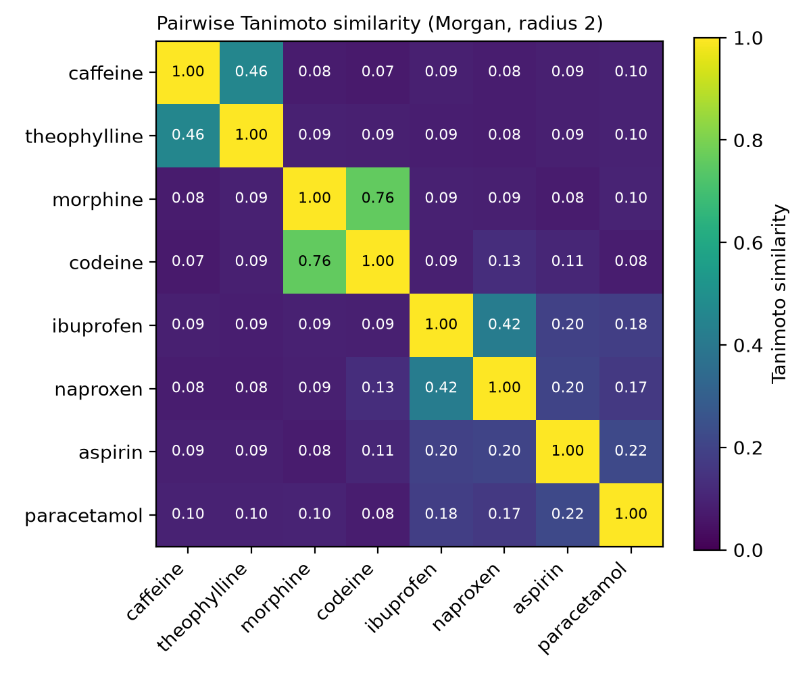

# Drug similarity through a computer's eyes

Do drugs from the same class also look similar to a computer? This notebook
compares eight drugs pairwise with Morgan fingerprints and Tanimoto similarity
using RDKit.



**Result:** The three structural pairs scored highest: morphine and codeine
(0.76), caffeine and theophylline (0.46) and ibuprofen and naproxen (0.42).
Aspirin and paracetamol, both common painkillers, scored only 0.22, so the
same use does not mean the same structure. All pairs from different classes
scored between 0.07 and 0.20.

## Drugs

| Pair | Class |
|---|---|
| caffeine, theophylline | xanthines |
| morphine, codeine | opioids |
| ibuprofen, naproxen | propionic-acid NSAIDs |
| aspirin, paracetamol | painkillers with different structures |

## Method

- Morgan fingerprint, radius 2, 2048 bits (`rdFingerprintGenerator`)
- Tanimoto similarity for every pair (`DataStructs.TanimotoSimilarity`),
  28 unique pairs in total
- A check cell confirms that a molecule compared with itself gives exactly 1.0

## Observations

- **Similarity depends on molecule size.** Caffeine and theophylline differ by
  only one methyl group, yet score 0.46. In a small molecule a single change
  alters a large share of the fingerprint. Morphine and codeine also differ by
  one methyl group (OH vs OCH3), but in a larger molecule, and score 0.76.
- **Same use, different structure.** Aspirin is barely more similar to
  paracetamol (0.22) than to ibuprofen and naproxen (0.20 each). The
  fingerprint compares structure, not what a drug is used for, so the two
  painkillers do not form a pair of their own the way the other classes do.

## Usage

```bash
conda install -c conda-forge rdkit matplotlib jupyterlab
jupyter lab drug_similarity.ipynb
```

## What I learned

- A function that only contains `pass` returns `None`. My check cell failed
  with an `AssertionError` until I added `return` to both functions.
- A parameter such as `smiles` in `def fingerprint(smiles):` is a variable
  that gets its value when the function is called.
- In the pair loop, starting the inner loop at `i + 1` compares every pair
  once: 28 lines instead of 64 with self-matches and duplicates.
- A missing comma in a dictionary made Python report an error on the line
  *after* the real mistake. Python shows where it noticed the problem, not
  always where the problem is.

## Related

- [Functional Group Finder](https://github.com/batugez/cheminformatics-learning):
  searches a molecule for predefined SMARTS patterns. This project instead
  compares two whole molecules through their fingerprints. A Morgan
  fingerprint can be seen as an automatic version of that idea: it records
  every small atom neighbourhood in a molecule, not just the named groups.

## Note

Built as a learning project with guidance from an AI assistant (Claude).
